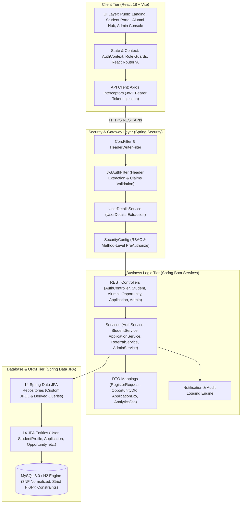
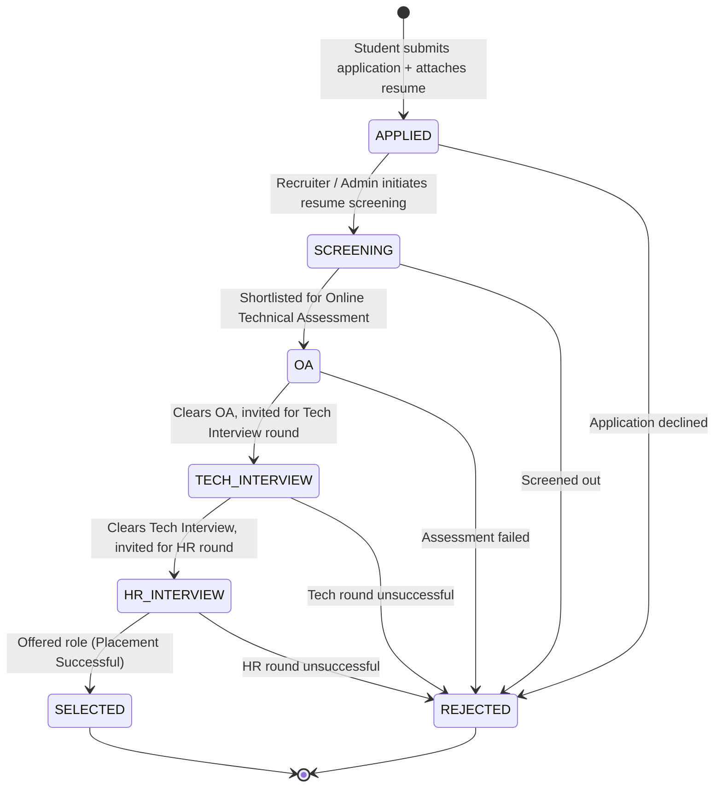
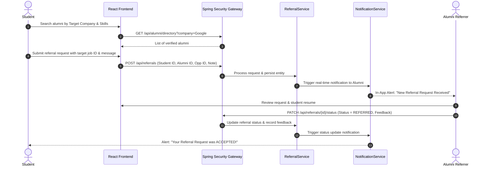
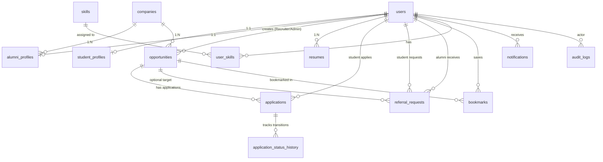

# 🎓 SETU - Campus Opportunity & Referral Hub

> **Enterprise-Ready Java Full Stack Platform (Target: EY GDS / Senior SDE Level)**  
> A high-performance, portfolio-grade system bridging Students, Alumni Referrers, Corporate Recruiters, and Administrators for campus placements, referral marketplaces, and recruitment analytics.

[](https://www.oracle.com/java/)
[](https://spring.io/projects/spring-boot)
[](https://spring.io/projects/spring-security)
[](https://reactjs.org/)
[](https://vitejs.dev/)
[](https://www.mysql.com/)
[](LICENSE)

---

## 🏛️ System Architecture & Engineering Blueprint

### 1. Multi-Tier Layered Architecture



---

### 2. Application Lifecycle State Machine (Kanban Progression)

The application lifecycle follows a strict state machine pattern with automatic historical audit logging on every stage transition:



---

### 3. Alumni Referral Matching Flow



---

### 4. Database Entity-Relationship Diagram (ERD)



---

## 🔥 Comprehensive Feature Matrix

| Feature Module | Capabilities & Technical Highlights |
| :--- | :--- |
| **Authentication & RBAC** | Stateless JWT authentication, BCrypt password hashing, pre-configured roles (`ROLE_STUDENT`, `ROLE_ALUMNI`, `ROLE_ADMIN`), auto token persistence in `localStorage`. |
| **Student Portal** | Profile completeness meter, skill proficiency tagging, multi-resume link management, job explorer with multi-param search/filtering, interactive Kanban tracker with stage timeline. |
| **Alumni Referral Hub** | Directory of verified alumni searchable by target company, status update workflow (`ACCEPTED`, `REFERRED`, `INFO_NEEDED`, `DECLINED`), advice notes. |
| **Admin Console** | System-wide analytics (total placements, application conversion rates), user account activation/suspension, job verification queue, system audit trail. |
| **Notification Engine** | Real-time notifications for application status shifts, referral acceptances, and verification approvals with unread count tracking. |
| **SaaS UI/UX Design System** | Modern dark glassmorphism theme, curated HSL color palette, typography hierarchy (Inter & JetBrains Mono), smooth CSS micro-animations, mobile responsive layouts. |

---

## 🛠️ Technology Stack Breakdown

| Tier | Component | Technology Selection | Rationale / Benefits |
| :--- | :--- | :--- | :--- |
| **Frontend** | Framework | **React 18.2** | Component reusability, virtual DOM performance, hook-based state management. |
| | Build Tool | **Vite 5.1** | Sub-second HMR (Hot Module Replacement) and optimized production bundles. |
| | Routing | **React Router v6** | Declarative nested routing with custom `ProtectedRoute` RBAC guards. |
| | HTTP Client | **Axios 1.6** | Centralized instance with automatic Bearer JWT injection & 401 interceptors. |
| | Design | **Vanilla CSS3** | Maximum CSS custom property control, zero framework bloat, glassmorphism. |
| **Backend** | Language | **Java 17 LTS** | Sealed classes, records, text blocks, strong typing, and enterprise runtime. |
| | Framework | **Spring Boot 3.2.3** | Automated dependency injection, embedded Tomcat 10, starter modules. |
| | Security | **Spring Security 6** | Method-level authorization (`@PreAuthorize`), stateless session policy. |
| | ORM | **Spring Data JPA** | Hibernate ORM, repository abstraction, auto dialect resolution. |
| **Database** | RDBMS | **MySQL 8.0 / H2** | Strict 3NF normalization, foreign key integrity, non-clustered B-tree indexes. |

---

## ⚡ Quick Start & Setup Guide

### 1. Prerequisites
- **JDK 17** or higher installed (`java -version`)
- **Node.js 18+** and **npm** installed (`npm -v`)

---

### 2. Launch Backend Application

```bash
# Navigate to the backend directory
cd backend

# Execute the local Maven wrapper to compile and run Spring Boot
./mvnw spring-boot:run
```
> Backend starts at **`http://localhost:8080`**  
> H2 In-Memory Console available at **`http://localhost:8080/h2-console`**

---

### 3. Launch Frontend Application

```bash
# Navigate to the frontend directory
cd frontend

# Install node packages
npm install

# Start Vite dev server
npm run dev
```
> Frontend application starts at **`http://localhost:5173`**

---

## 🔑 Pre-Seeded Demo Credentials

Use the one-click demo credentials on the login screen to test each role:

```tsv
Role       Email                     Password     Key Testing Highlights
--------------------------------------------------------------------------------------------------
Student    rahul.sharma@example.com  Student@123  Explore Jobs, Kanban Board, Request Referrals
Alumni     priya.patel@example.com   Alumni@123   Manage Incoming Referrals, Profile & History
Admin      admin@campus.hub          Admin@123    Platform Analytics, User Moderation, Audit Logs
```

---

## 🔌 REST API Endpoints Specification

### 🔐 Authentication Controller (`/api/auth`)
- `POST /api/auth/register` — Register a new Student or Alumni user
- `POST /api/auth/login` — Authenticate credentials and receive JWT token

### 🎓 Student Controller (`/api/student`)
- `GET /api/student/profile/{userId}` — Fetch student profile, skills, resumes & completion %
- `PUT /api/student/profile/{userId}` — Update academic details, skills, and resume links

### 💼 Alumni Controller (`/api/alumni`)
- `GET /api/alumni/directory` — List verified alumni (filterable by target company)
- `GET /api/alumni/profile/{userId}` — Fetch alumni profile details
- `PUT /api/alumni/profile/{userId}` — Update alumni designation, experience, and referral slots

### 💼 Opportunity Controller (`/api/opportunities`)
- `GET /api/opportunities` — Search and filter job listings by title, company, type, and work mode
- `GET /api/opportunities/{id}` — Fetch detailed opportunity specifications
- `POST /api/opportunities` — Create new job listing (Recruiter / Admin)
- `POST /api/opportunities/{id}/bookmark` — Toggle opportunity bookmark

### 📑 Application Controller (`/api/applications`)
- `POST /api/applications` — Submit job application with attached resume ID & cover letter
- `GET /api/applications/student/{studentId}` — Fetch all student applications
- `PATCH /api/applications/{id}/status` — Advance application status in recruitment pipeline

### 🤝 Referral Controller (`/api/referrals`)
- `POST /api/referrals` — Send referral request to alumni
- `GET /api/referrals/student/{studentId}` — Fetch student's outbound referral requests
- `GET /api/referrals/alumni/{alumniId}` — Fetch alumni's inbound referral requests
- `PATCH /api/referrals/{id}/status` — Update referral request status & add feedback notes

### 📊 Admin Controller (`/api/admin`)
- `GET /api/admin/users` — List all registered users
- `PATCH /api/admin/users/{userId}/status` — Toggle user account status (`ACTIVE` / `SUSPENDED`)
- `GET /api/admin/opportunities/pending` — Fetch job listings awaiting verification
- `PATCH /api/admin/opportunities/{id}/verify` — Approve or reject pending job listings
- `GET /api/admin/audit-logs` — Access immutable system security audit logs

---

## 📜 Project Structure

```
SETU/
├── backend/
│   ├── pom.xml
│   ├── mvnw & mvnw.cmd
│   └── src/main/
│       ├── java/com/campus/hub/
│       │   ├── entity/            # 14 Core JPA Entities
│       │   ├── repository/        # 14 JPA Repositories
│       │   ├── dto/               # Request/Response Data Transfer Objects
│       │   ├── service/           # 9 Business Logic Services
│       │   ├── controller/        # 9 REST Controllers
│       │   ├── security/          # JwtUtils, JwtAuthFilter, SecurityConfig
│       │   └── exception/         # GlobalExceptionHandler & Custom Exceptions
│       └── resources/
│           ├── application.properties
│           ├── schema-h2.sql      # Database DDL
│           └── data-h2.sql        # Database Seed Data
└── frontend/
    ├── package.json
    ├── vite.config.js
    └── src/
        ├── index.css              # Premium SaaS Dark Design System
        ├── App.jsx                # React Router v6 Configuration
        ├── services/api.js        # Centralized Axios Client & JWT Interceptors
        ├── context/AuthContext.jsx # Authentication State Provider
        ├── components/            # Sidebar, ProtectedRoute, UI Components
        └── pages/                 # 15 React Pages (Student, Alumni, Admin)
```

---

## 📄 License

Distributed under the **MIT License**. See `LICENSE` for details.
